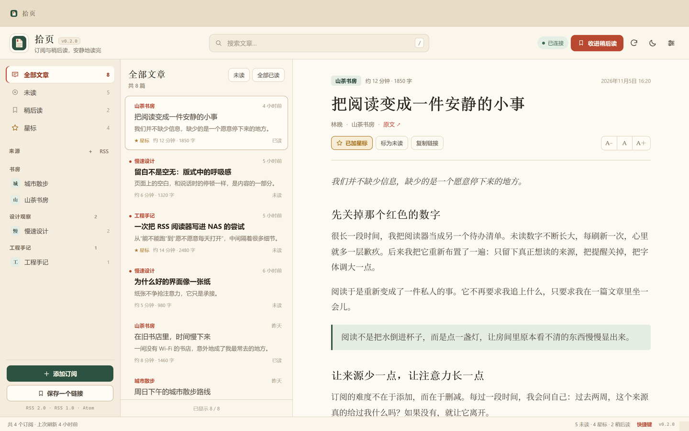

# 拾页

拾页是 TOS 7 上的一个本地阅读收件箱：订阅喜欢的 RSS / Atom 来源，也把任何一篇文章的链接收进稍后读。正文会在 NAS 上提取、清洗并留下来，之后打开就能安静地读完。

它不依赖外部账号，不把订阅和阅读记录上传到第三方。作者与发布者：**Yuii**。

- 当前版本：**0.2.0**
- 许可证：**MIT**
- 仓库：<https://github.com/642671/shiye-tos7>

## 设计来源

拾页不是对某个项目的代码复刻。产品形态和交互参考了两个成熟的开源 RSS 阅读器：

- [Miniflux](https://github.com/miniflux/v2)：极简的三栏布局、已读/未读模型、键盘操作和自托管优先的理念。
- [FreshRSS](https://github.com/FreshRSS/FreshRSS)：订阅分类、OPML 导入导出、刷新策略和长期维护的社区型产品结构。

正文提取的思路受 [Mozilla Readability](https://github.com/mozilla/readability) 等通用可读性方案启发，但实现是基于 Python 标准库重新编写的容器评分与清洗流程，没有引入上述项目的源码。它们的许可证仅作为设计参考，不构成代码授权关系。

## 界面预览



浅色纸张主题下的三栏布局：左侧是订阅与分类，中间是收件箱列表，右侧是阅读区。截图使用本地演示数据，不含真实阅读记录。

## 功能

### 阅读收件箱

- 订阅 RSS 2.0、RSS 1.0（RDF）和 Atom 1.0；粘贴站点首页时自动发现订阅源。
- 把任意网页链接收进「稍后读」，不需要先有订阅源。
- 保存链接时在服务端提取正文；只拿到链接时也可以先保存，之后再从阅读区重新提取。
- 同一链接自动去重；稍后读文章可单独移出，不影响原网站。
- 全部 / 未读 / 稍后读 / 星标四种视图，可按订阅或分类筛选。
- 找不到文章时不再显示生硬的“内容不存在”，而是说明文章已不在收件箱里，并提供回到全部文章的操作。

### 阅读体验

- 三栏布局：来源树、文章列表、正文阅读区；窄屏切换为抽屉导航和全屏阅读层。
- 正文使用适合长文的衬线字体，支持 15–22px 字号调整，偏好保存在本地。
- 阅读进度条只反映可滚动正文，打开文章时从 0 开始。
- 文章只有摘要或正文提取失败时，阅读区给出明确的上下文说明，并提供「重试加载」「提取正文」或「打开原文」。
- 浅色纸张 / 深色墨夜 / 跟随系统三种主题。
- 键盘快捷键：`j/k` 切换文章，`m` 标记已读，`s` 星标，`r` 刷新，`l` 保存链接，`/` 聚焦搜索，`?` 查看全部快捷键。

### 订阅与维护

- 识别 UTF-8、GBK、GB18030、Big5 等常见编码，兼容 BOM 和 XML 声明。
- 使用 ETag / Last-Modified 条件请求，支持 gzip / deflate，限制重定向次数、抓取体积和超时。
- 订阅分类管理，支持重命名、删除、启用/停用和单独刷新。
- OPML 2.0 导入导出，便于从其他阅读器迁移。
- 后台调度每 20 秒检查到期订阅，最多 3 个抓取线程；失败按 5 / 15 / 60 / 180 / 360 分钟退避。
- 每小时清理过期文章，可按保留天数和每个订阅的最大文章数配置。
- 搜索基于小写化文本索引，中文、日文等无空格语言也能稳定匹配。

### 安全与本地优先

- 正文在服务端按白名单清洗后才下发：移除脚本、事件属性、iframe、表单、跟踪参数和 1×1 跟踪像素。
- 图片经本地代理 `api/media` 加载，避免混合内容和第三方 Referer 泄漏。
- 前端 CSP 禁止内联脚本和外部脚本源；用户可见元数据一律通过 `textContent` 渲染。
- 全部数据保存在本地 SQLite，应用不收集遥测。

## 安装

安装包由仓库中的 `build.py` 生成。以 x86_64 为例：

```bash
sudo dpkg -i shiye_0.2.0_x86_64.deb
```

安装脚本会：

1. 创建 `shiye` 系统用户（可用时加入 `allusers` 组）。
2. 解压前端资源到 `/usr/local/shiye/webui`。
3. 安装并启用 `shiye-system.service`，启动后等待 `/var/api/shiye.sock` 出现。
4. 启动失败时把诊断信息写入 `/usr/local/shiye/logs/postinst-diagnostic.txt`。

检查服务状态：

```bash
sudo systemctl status shiye-system.service
curl --unix-socket /var/api/shiye.sock http://localhost/api/health
```

健康检查返回的 JSON 中 `"app"` 必须是 `"shiye"`，只看到 HTTP 200 不足以说明服务正常。

> 卸载会删除 `/usr/local/shiye`（包括数据库）。卸载前请先在设置中导出 OPML。

```bash
sudo dpkg -r shiye   # 停止服务并删除应用目录
sudo dpkg -P shiye   # 额外删除系统用户/组
```

## 本地开发

要求：

- Python 3.10+（CI 使用 3.12）
- Node.js 18+（仅用于前端语法检查和 `node:test`，运行时不需要 Node）

后端不使用第三方依赖。启动一个本地 TCP 实例：

```bash
SHIYE_PORT=8787 \
SHIYE_DATA_DIR=./data \
SHIYE_FRONTEND_DIR=./frontend \
python backend/shiye-service
```

然后访问 <http://127.0.0.1:8787/>。

### 测试

```bash
python -m compileall -q backend
python -m unittest discover -s backend/tests -v

node --check frontend/theme.js
node --check frontend/tools.js
node --check frontend/app.js
node --test tests/frontend_tools.test.js
```

测试覆盖订阅解析、编码识别、HTML 清洗、正文提取、SQLite 持久化、服务层逻辑、HTTP 路由、静态资源、生命周期脚本和打包契约。网络请求在单元测试中全部被 mock，不会访问真实站点。

### 构建

```bash
python build.py --platform x86_64
python build.py --platform aarch64
```

产物写入 `dist/`：

- `shiye_0.2.0_x86_64.deb` / `.sha256`
- `shiye_0.2.0_aarch64.deb` / `.sha256`

构建固定文件属主、时间戳、归档条目顺序和压缩参数，同一工具链下可复现。不同 zlib 版本的压缩流可能产生不同字节，发布资产以对应 `.sha256` 为准。不要通过重命名 `.deb` 伪造架构。

## 目录结构

```text
backend/shiye/            Python 服务（feeds / readable / sanitize / store / service / server）
backend/tests/           后端单元测试与打包契约测试
frontend/                原生 HTML/CSS/JS
init.d/                  systemd 单元
DEBIAN/                  postinst / prerm / postrm 和 control
images/icons/            应用图标
docs/                    架构、目录和 TOS 7 规范说明
tests/                   前端 Node 测试
build.py                 确定性打包脚本
config.ini               TOS 应用元数据
shiye.lang               14 种语言的商店文案
```

## 数据与隐私

- 数据库位置：`/usr/local/shiye/data/shiye.db`。
- 应用不收集遥测，不向任何统计服务上报阅读行为。
- 抓取订阅、保存链接和加载图片时，目标站点可见的来源是本机，而不是 TOS 账号。
- 正文在服务端按白名单清洗后才下发，前端只把清洗后的 HTML 插入阅读区；标题、作者等元数据一律通过 `textContent` 渲染。
- 应用自身不做登录鉴权，访问控制由 TOS 的 iframe 代理会话负责。请勿把 socket 直接暴露到公网。

## 已知限制

- 正文提取是基于 HTML 结构的启发式算法，不执行页面 JavaScript；强依赖前端渲染、登录或付费墙的页面可能只能保存链接。
- 不解析播客/视频 enclosure，也不做内嵌播放。
- 单用户本地应用，没有多账号或跨设备同步。
- 保存链接和图片代理都会按用户提供的 http(s) 地址发起请求，本质上是一个受限的 SSRF 面；默认只应在可信内网使用。
- 本版本已完成 Windows 环境的自动化测试、浏览器冒烟检查和双架构打包，尚未在真实 TOS 7 设备上完成安装验收；相关清单见 `docs/TOS7_SPEC_COMPLIANCE_CN.md`。

## 反馈与维护

- 缺陷报告：使用仓库的 Bug Report 模板，附版本号、TOS 版本和复现步骤。
- 功能建议：使用 Feature Request 模板，说明使用场景而不是只描述实现方式。
- 安全问题：不要公开提 issue，见 `SECURITY.md`。
- 版本计划：见 `ROADMAP.md` 和 `CHANGELOG.md`。

## 许可证

MIT License，Copyright (c) 2026 Yuii。见 [LICENSE](LICENSE)。

## 致谢

- [Miniflux](https://github.com/miniflux/v2) 与 [FreshRSS](https://github.com/FreshRSS/FreshRSS)：产品形态和长期维护方式的参考。
- [Mozilla Readability](https://github.com/mozilla/readability)：正文可读性提取的通用思路参考。
- TOS 7 iframe 应用规范与社区踩坑记录：`TOS7_APP_IFRAME_DEVELOPMENT_NOTES.md`（工作区上级目录）。
